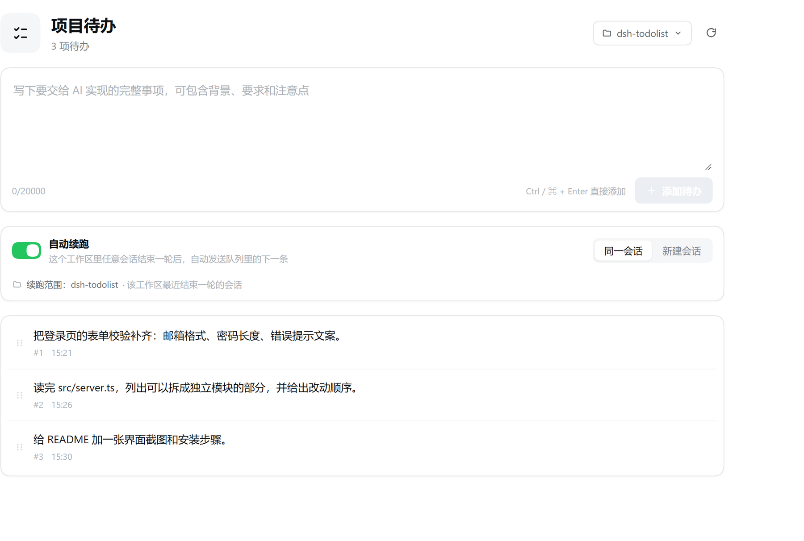

# dsh-todolist · 待办事项 / Todo Queue

Line up your next prompts while the model is still working. A per-workspace queue panel in the DSH Web GUI: write the next tasks, order them, and the first one is sent automatically when a turn in that workspace ends — into the same session or into a fresh one.



## What it does

- **A queue per workspace.** Every workspace has its own list; items you wrote in one project never leak into another.
- **Auto-continue.** With the switch on, when any session in that workspace finishes a turn, the first pending item is sent into it — as the next queued turn (same session) or into a newly created session (`同一会话` / `新建会话`). Sending happens in the background: the page does not jump, the composer keeps its focus.
- **Manual control too.** `▶ 开始` sends an item now; `💬 填入对话` only drops its text into the session composer without sending.
- **Draft safety.** The composer keeps 20000 characters and saves what you typed per workspace, so switching sessions, switching panels or reloading the page does not lose it.
- **Attachments.** A todo can carry images and text files (`txt` / `md` and friends), because a todo usually becomes a prompt: images are sent as image parts, text files are inlined as text, up to 6 per item. Images are downscaled to 1400px JPEG before they are stored.
- **Editing.** Drag the handle to reorder, double-click a title to edit it in place, `✓` marks an item done (and `↺` reopens it), `🗑` deletes it, and completed items can be cleared in one click. Row actions stay visible instead of appearing on hover.
- **Durable storage.** Items are written by the plugin's host half to `<profile>/plugin-data/dsh-todolist/state.json` — the queue survives GUI restarts and port changes.

## Install

From the DSH plugin page (**插件 → 添加插件**) pick this directory, or from a shell:

```sh
dsh plugin add github:omnijk/dsh-todolist
```

After installing, a **待办事项 / Todo queue** entry appears in the sidebar.

## Usage

1. Open **待办事项** in the sidebar (it is a full main panel, not an overlay).
2. Type the next thing you want the model to do and press `Ctrl / ⌘ + Enter`, or click `+ 添加待办`. Repeat for as many items as you like; they run in list order.
3. Turn on **自动续跑 / Auto-continue** and choose where the queue continues: the same session, or a new session per item. `续跑范围` shows which workspace's sessions are watched.
4. Keep something in the composer while the current turn runs — the queue picks it up when the turn ends.

`▸ 开始` on a row sends that item immediately; `💬 填入对话` only prefills the composer for you to review.

## Notes

- Auto-continue watches sessions of the workspace shown in the panel header, and ignores subagent sessions.
- If a send fails (for example the session was archived), the item is put back at the front of the queue and the panel shows the reason; the page never navigates on its own.
- The queue is a helper, not a scheduler: items are sent as soon as a watched turn ends, not at a wall-clock time.

## Data

`<profile>/plugin-data/dsh-todolist/state.json` — plain JSON, keyed by workspace id:

```json
{ "version": 1, "workspaces": { "<workspaceId>": {
  "items": [{ "id": "...", "text": "...", "title": "...", "status": "pending", "createdAt": 0 }],
  "autoRun": true, "mode": "same", "sessionId": null, "draft": ""
} } }
```

Deleting the file (or the workspace entry) clears the queue for that workspace.

## Files

| File | Purpose |
| --- | --- |
| `index.js` | Host half: registers `/api/todolist.state` (GET reads, POST merges and writes) with atomic JSON writes |
| `client.js` | Client half: main panel, sidebar entry, queue interactions, auto-continue listener |
| `cordis.patch.yml` | Bundle patch that inserts the plugin into a profile |
| `locale/*.json` | Chinese and English strings plus the plugin metadata |
| `docs/DETAIL.md` | Plugin detail page |

More detail in [docs/DETAIL.md](docs/DETAIL.md).

## License

MIT

---

# 中文说明

把下一段提示词先排好队。模型正在跑当前这一轮的时候，你可以在侧边栏的「待办事项」面板里把接下来要做的事一条条写好、排好序；这一轮结束，队列第一条会自动发出去开始新事项——可以留在同一个会话里继续，也可以每条都新开一个会话。

## 功能

- **按工作区的队列**：每个工作区一份列表，互不干扰。
- **自动续跑**：打开开关后，这个工作区里任意会话结束一轮，队列第一条自动发出；`同一会话` 追加在原来那个会话里，`新建会话` 每条新开一个会话。发送在后台完成，页面不跳转、不抢焦点。
- **手动控制**：`▸ 开始` 立刻发送该条；`💬 填入对话` 只把文本填进输入框，不发送。
- **草稿不丢**：输入框 20000 字上限，写了一半切会话、切面板、刷新页面都不会丢（草稿按工作区保存）。
- **附件**：一条待办可以带图片和文本文件（`txt` / `md` 等），因为待办最终就是提示词——图片按 image part 发送，文本文件内联成文本，每条最多 6 个；图片入库前会压到 1400px 的 JPEG。
- **编辑**：拖动手柄排序，双击标题就地编辑，`✓` 标记完成 / `↺` 恢复待办，`🗑` 删除，可一键清除已完成；行内按钮常显，不再需要悬浮。
- **持久化**：数据由插件 Host 半写入 `<profile>/plugin-data/dsh-todolist/state.json`，重启 GUI、换端口都不丢。

## 安装

在「插件」页点「+ 添加插件」选择本目录，或命令行：

```sh
dsh plugin add github:omnijk/dsh-todolist
```

安装后侧边栏出现「待办事项」入口。

## 用法

1. 侧边栏打开「待办事项」（完整主面板）。
2. 写下接下来要做的事，`Ctrl / ⌘ + Enter` 或点「+ 添加待办」，可以连续加多条，按列表顺序执行。
3. 打开「自动续跑」，选「同一会话」或「新建会话」；「续跑范围」显示监听的哪个工作区。
4. 当前这一轮还在跑的时候就可以继续写，这一轮结束队列会自动接下一条。

## 注意

- 自动续跑只监听面板头部那个工作区的会话，并忽略子代理会话。
- 发送失败（例如会话被归档）会把该条放回队首并在面板提示原因，页面不会自动跳转。
- 它不是定时任务：只会在一轮结束时立即发送，不会按钟点等待。

## 许可

MIT
